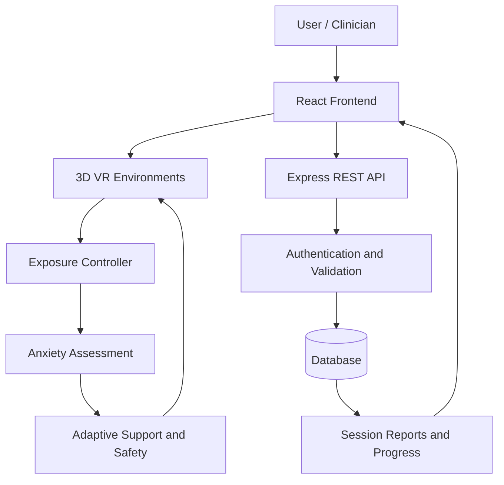

# MindSphere-VR — Technical Design Document

## 1. Introduction

MindSphere-VR is a web-based immersive exposure platform that combines 3D environments, user-reported anxiety assessment, adaptive exposure control, guided breathing, and session reporting.

## 2. System Architecture

The system consists of five main layers:

1. **Presentation Layer:** React-based interface for authentication, assessment, scenario selection, session controls, and reporting.
2. **3D Environment Layer:** Three.js-based environments for accident/traffic exposure, confined-space exposure, and relaxation.
3. **Decision Layer:** An adaptive rule-based controller that adjusts exposure according to user-reported anxiety.
4. **Backend Layer:** Node.js and Express APIs for authentication, session management, anxiety records, and progress retrieval.
5. **Data Layer:** A database for storing authorized user records, session summaries, anxiety observations, and clinician notes.

## 3. Architecture Diagram



## 4. Main Modules

### 4.1 Authentication and Consent

Manages user registration, login, access control, and consent status. Passwords must be securely handled through an established authentication mechanism.

### 4.2 VR Environment Module

Loads the selected environment and provides interactive camera controls, scene details, and exposure-level changes.

### 4.3 Anxiety Assessment Module

Collects user-reported anxiety on a scale from 0 to 10. Observations are associated with timestamps and the current exposure level.

### 4.4 Adaptive Exposure Controller

Uses predefined rules to determine whether to continue, maintain, reduce, or pause exposure. Environmental changes depend on the selected scenario.

### 4.5 Guided Support and Safety

Displays supportive prompts and breathing guidance. Users can stop exposure and move to the calming environment at any time.

### 4.6 Session Management

Records session start and end times, anxiety observations, exposure progression, pause events, and post-session feedback.

### 4.7 Progress and Clinician Review

Displays session history and anxiety trends. Authorized clinicians can review available session information and save review notes.

## 5. Adaptive Exposure Algorithm

### Inputs

- Pre-session anxiety rating
- Current user-reported anxiety
- Current exposure level
- Previous anxiety observation
- User pause or stop action

### Decision rules

| Anxiety rating | Default system response |
|---|---|
| 0–3 | Continue; consider gradual progression if appropriate |
| 4–6 | Maintain exposure and offer support |
| 7–8 | Reduce environmental intensity and offer calming guidance |
| 9–10 | Pause exposure and activate the safety interface |

These thresholds are configurable design rules, not clinically validated treatment thresholds. User choice and safety controls take priority over automatic progression.

### Pseudocode

```text
START SESSION
Collect pre-session anxiety
Initialize exposure level

WHILE session is active:
    Collect anxiety rating
    Save rating with timestamp

    IF user requests stop:
        End exposure safely

    ELSE IF anxiety >= 9:
        Pause exposure
        Offer breathing or calming environment

    ELSE IF anxiety >= 7:
        Reduce environmental intensity
        Offer calming guidance

    ELSE IF anxiety >= 4:
        Maintain current exposure
        Offer support

    ELSE:
        Continue at a comfortable level
        Consider gradual progression

    IF user requests pause:
        Pause exposure immediately

END SESSION

Collect post-session anxiety
Generate session report
Save session record
```

## 6. Environment Adaptation

### Accident / Traffic

Exposure can change through traffic density, vehicle movement, environmental activity, and sound intensity.

### Elevator / Confined Space

Exposure can change through door state, elevator movement, and duration in the enclosed environment.

### Calming Environment

Provides a quieter natural setting with reduced stimulation, intended for user-requested relaxation or recovery after a pause.

## 7. Data Model

### User

- `id`
- `name`
- `email`
- `consentStatus`
- `createdAt`

### Session

- `id`
- `userId`
- `scenario`
- `startTime`
- `endTime`
- `duration`
- `preAnxiety`
- `peakAnxiety`
- `postAnxiety`
- `exposureLevelReached`
- `pauseCount`
- `feedback`

### Anxiety Observation

- `id`
- `sessionId`
- `timestamp`
- `anxietyLevel`
- `exposureLevel`

### Clinician Note

- `id`
- `sessionId`
- `clinicianId`
- `note`
- `createdAt`

The schema must be adapted to the database actually used by the application.

## 8. API Design

Proposed REST endpoints:

| Method | Endpoint | Purpose |
|---|---|---|
| POST | `/api/auth/register` | Register a user |
| POST | `/api/auth/login` | Authenticate a user |
| POST | `/api/sessions` | Create or save a session |
| POST | `/api/anxiety` | Save an anxiety observation |
| GET | `/api/sessions/:userId` | Retrieve authorized session history |
| GET | `/api/session/:sessionId` | Retrieve a session report |
| GET | `/api/progress/:userId` | Retrieve progress data |
| GET | `/api/clinician/users` | Retrieve permitted user records |
| POST | `/api/clinician/notes` | Save a clinician review note |

These are proposed endpoints; document the actual routes implemented in the code.

## 9. Security and Privacy

- Use secure authentication and password hashing.
- Validate all user inputs on the backend.
- Apply role-based authorization to clinician functions.
- Restrict access to each user's records.
- Keep credentials and secrets outside source control.
- Use HTTPS in deployment.
- Store only necessary personal information.
- Avoid collecting physiological data unless the relevant hardware and consent are available.

## 10. Limitations

- Anxiety scores are self-reported, not direct physiological measurements.
- Rule-based exposure decisions are not a substitute for clinical judgment.
- WebXR availability depends on the browser and device.
- The system requires usability, performance, and safety testing before clinical use.

## 11. Future Enhancements

Potential enhancements include compatible wearable integration, improved 3D assets, clinician-supervised evaluations, and carefully validated personalization.
